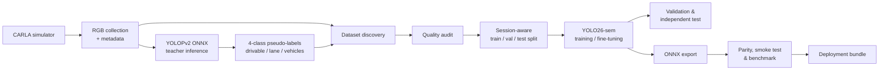

<div align="center">

# RoadForge

### A simulation-to-model workbench for road-scene semantic perception

**Collect · Annotate · Audit · Fine-tune · Evaluate · Deploy**

[](https://www.python.org/)
[](https://doc.qt.io/qtforpython-6/)
[](https://docs.ultralytics.com/)
[](#installation)
[](LICENSE)
[](https://github.com/ArvinNotDev/RoadForge/actions/workflows/tests.yml)

**RoadForge** is a desktop research and engineering environment for building road-scene semantic-segmentation datasets from CARLA, generating YOLOPv2 teacher pseudo-labels, fine-tuning YOLO26 semantic models, evaluating generalization, and preparing ONNX deployment artifacts.

</div>

---

## Why RoadForge?

Autonomous-driving perception experiments are rarely limited to training a neural network. They require a traceable data-generation protocol, annotation, dataset quality control, leakage-aware splitting, repeatable experiments, independent evaluation, and deployment validation.

RoadForge brings those stages into one workflow. It is designed for experiments in which **CARLA provides controllable simulation data**, a **YOLOPv2 ONNX model acts as an offline teacher**, and a **YOLO26 semantic-segmentation model is trained or fine-tuned as the student**.

The project is useful as a foundation for research prototypes, simulation-driven dataset generation, semantic perception experiments, and model-development portfolios. It is not a complete autonomous-driving stack and does not claim safety certification.

## End-to-end workflow



## Core capabilities

| Stage | Capabilities |
|---|---|
| **Simulation data acquisition** | PySide6 collector for CARLA; dynamically enumerated installed maps, weather, ego vehicle, optional background traffic, RGB camera, capture cadence, and metadata |
| **Teacher-based annotation** | One YOLOPv2 ONNX teacher for drivable area, lane lines, and COCO vehicle detections; GrabCut/box vehicle-mask extraction; four-class targets; preview and legacy reannotation |
| **Dataset management** | Collection discovery, metadata filters, image/mask pairing, manifest-aware label selection, non-destructive preparation, optional quality-aware downsampling with town/session and rare-class coverage |
| **Quality assurance** | Decode and dimension checks, class-ID validation, empty-mask warnings, duplicate filename detection, SHA-256 duplicate-frame detection, complete JSON audit report |
| **Leakage-aware splitting** | Collection-session grouping, exact-duplicate group linking, seeded train/validation/test assignment, optional held-out-town evaluation |
| **Model training** | YOLO26 semantic model scales (`n`, `s`, `m`, `l`, `x`), pretrained checkpoint fine-tuning, architecture-only initialization, pause/stop at checkpoint boundaries, resume support; AVIS image-level multi-task classification with ResNet18 or EfficientNet-B0 |
| **Experiment tracking** | Versioned training configurations, per-run snapshots, logs, metrics, split manifests, run metadata, and local model registry |
| **Evaluation** | Per-class IoU, precision, recall, Dice, pixel accuracy, mean pixel accuracy, mIoU, foreground mIoU, confusion matrix, CSV/JSON reports |
| **Inference & deployment** | Image, folder, video, and webcam inference; ONNX export and graph validation; PyTorch/ONNX parity; warmed-up benchmark; deployment package |

## Semantic task definition

RoadForge's current training pipeline uses a four-class semantic label map.

| ID | Class | Description |
|---:|---|---|
| `0` | `background` | Pixels outside the three target regions |
| `1` | `ego_drivable_area` | Drivable road area predicted by the teacher |
| `2` | `lane_lines` | Lane-line pixels predicted by the teacher |
| `3` | `vehicles` | Cars, motorcycles, buses, and trucks detected by YOLOPv2 |

The canonical label is an **8-bit, single-channel grayscale PNG** whose dimensions match the source RGB image. The combined target is stored under `labels_yolopv2/<Town>/combined_4class/`. Vehicle pixels (class 3) take precedence over lane lines (class 2), which take precedence over drivable area (class 1). YOLOPv2's vehicle detector provides boxes, not native instance masks: RoadForge uses GrabCut to estimate silhouettes and records any box-fill fallbacks. All vehicle masks remain teacher pseudo-labels and should be previewed and audited.

> **Scientific distinction:** labels generated by the YOLOPv2 teacher are pseudo-labels, not automatically verified ground truth. A student model evaluated against those masks is being measured for agreement with the teacher-derived targets. Strong claims about real-world semantic accuracy require an independent, preferably human-annotated, test set.

For the complete data contract, see [Dataset Format](docs/DATASET_FORMAT.md).

## Research and engineering design

### 1. Data provenance and non-destructive preparation

Raw collections remain separate from training artifacts. RoadForge discovers original images and their annotation-manifest entries, validates image/mask pairs, and **copies** valid pairs into a prepared dataset. The source collection is not rewritten or moved by dataset preparation.

Every prepared sample is recorded with its source path, prepared path, town, collection, session/group ID, route ID, weather, and traffic metadata.

### 2. Split design that respects collection structure

Randomly splitting individual frames can place near-identical neighboring frames from one simulation session in both training and test sets. RoadForge instead assigns complete collection-session groups to one split. It also links groups that contain byte-identical frames using SHA-256 hashes, preventing exact duplicate images from crossing split boundaries.

An optional town holdout assigns complete groups containing selected towns to the test split. This supports more demanding domain-shift experiments, although requested split ratios may change because groups are indivisible.

These mechanisms reduce common leakage risks; they do not prove statistical independence between all samples. See [Experimental Protocol](docs/EXPERIMENT_PROTOCOL.md).

### 3. Fine-tuning with explicit checkpoint semantics

RoadForge distinguishes two operations:

- **Fine-tuning:** start a new experiment from a selected `best.pt` or pretrained semantic checkpoint, using a new output directory and the active configuration.
- **Resume:** continue an interrupted experiment from its `last.pt` checkpoint and original run directory. The associated dataset YAML is checked before resuming.

The workbench accepts semantic checkpoints and rejects detection or instance-segmentation models. When a previous three-class semantic checkpoint is fine-tuned on the four-class dataset, shape-compatible backbone and neck tensors can transfer while the changed semantic class head is initialized for the new class count; the checkpoint compatibility report identifies transferred and newly initialized tensors.

### 4. Evaluation beyond one aggregate score

The evaluator processes every sample in the selected split and reports class-wise results as well as global metrics. Undefined per-class values remain `null` in JSON rather than being silently reported as zero. Validation is intended for model selection; the independent test split should be reserved for final reporting.

### 5. Deployment checks

ONNX export is followed by graph checking and an inference smoke test. RoadForge can compare PyTorch and ONNX predictions on the same image, report pixel-level agreement and parity metrics, and benchmark warmed-up inference. It also packages the ONNX model with class and preprocessing metadata plus an inference example.

For implementation details, see [Architecture](docs/ARCHITECTURE.md).

## Installation

### Requirements

- 64-bit Windows (the supplied setup and launch scripts are Windows batch files).
- Python **3.12** available as `py -3.12`.
- CARLA server and matching CARLA Python API, only if using the data collector.
- NVIDIA GPU and a compatible CUDA-enabled PyTorch/ONNX Runtime build are optional. CPU execution is supported where the installed framework/provider supports it.

### Install the application

```bat
git clone https://github.com/ArvinNotDev/RoadForge.git
cd RoadForge
setup.bat
run.bat
```

`setup.bat` creates a local `.venv` and installs the pinned application dependencies. It does not install CARLA or configure a CARLA server.

To start the raw data collector:

```bat
run_collector.bat
```

The collector requires the CARLA Python API matching the running CARLA server release. Expose the API through the Python environment before launching the collector, following the [official CARLA documentation](https://carla.readthedocs.io/).

### GPU setup

The default dependencies install the standard PyTorch/Ultralytics and ONNX Runtime packages. CUDA acceleration depends on the exact NVIDIA driver, CUDA runtime, PyTorch wheel, and ONNX Runtime provider installed on the machine.

For a CUDA-specific setup, install a PyTorch build compatible with the machine by following the [official PyTorch installation selector](https://pytorch.org/get-started/locally/). To use CUDA for YOLOPv2 ONNX annotation, install a compatible `onnxruntime-gpu` build instead of the CPU-only `onnxruntime` package. Check **Settings** in RoadForge to inspect the detected runtime and providers.

## Quick start

### A. Collect CARLA frames

1. Start the CARLA server.
2. Configure the matching CARLA Python API.
3. Launch `run_collector.bat`.
4. Select towns, weather, camera, capture target, ego vehicle, and optional background traffic.
5. Start collection. Raw RGB PNG frames and JSONL metadata are written to the selected output root.

The default reference camera is 640×384 at 120° FOV, mounted at `(1.4, 0.0, 2.2)` with a pitch of `-25°` and sensor tick of `0.03 s`. The defaults are configurable. The Collector reads the complete installed-map list from `Client.get_available_maps()` after connecting, so the UI is not limited to a legacy hard-coded Town list. Use the metadata saved with each collection as the experimental record.

### B. Generate pseudo-labels

1. Open the Data Collection application.
2. Select the existing collections and compatible YOLOPv2 ONNX model.
3. Choose the execution provider (Auto, CUDA, or CPU).
4. Keep **Detect vehicles and add the semantic vehicles class** enabled, then choose GrabCut silhouette or coarse bounding-box masks and set the confidence/NMS thresholds.
5. Run offline annotation and inspect the `Vehicle detections`, `Vehicle Mask`, and `Combined overlay` previews.
6. Confirm successful four-class entries in the annotation manifest.

The adapter expects the six-output YOLOPv2 ONNX graph: detection heads/anchors at outputs 0–3, drivable-area at output 4, and lane lines at output 5. It merges COCO car/motorcycle/bus/truck detections into class 3. The graph layout, COCO class order, preprocessing, and box decoding must match the documented adapter; it is not a universal adapter for arbitrary YOLOPv2 exports.

### C. Audit and prepare a dataset

1. Launch `run.bat` and open **Dataset Manager**.
2. Add the collection root and click **Rescan**.
3. Select collections and open **Dataset Quality & Splits**.
4. Validate the selected samples and review the report.
5. Choose train/validation/test ratios and a split seed. The default is 80/10/10.
6. Optionally reserve complete towns for the test split.
7. Optionally enable **quality-aware dataset reduction**, set a target sample count, and keep town/map balancing enabled to avoid over-representing one map or collection session.
8. Prepare a dataset copy under the RoadForge workspace. Selection metrics and before/after town and class coverage are saved in `dataset_report.json` and `split_manifest.json`; raw collections are never modified.

### D. Train or fine-tune a model

1. Open **Model & Training**.
2. Choose a YOLO26 semantic scale (`n`, `s`, `m`, `l`, or `x`).
3. Select an official/local `yolo26*-sem.pt` checkpoint to fine-tune, or use the corresponding semantic YAML architecture for a new initialization.
4. Select the prepared `data.yaml`, review the effective configuration, and start training.
5. Inspect results under `roadforge/workspace/runs/`.

A standalone Ultralytics example using a prepared dataset:

```python
from ultralytics import YOLO

model = YOLO("yolo26l-sem.pt", task="semantic")
results = model.train(
    data="path/to/prepared_dataset/data.yaml",
    epochs=100,
    imgsz=512,
    batch=2,
    seed=42,
    deterministic=True,
)
```

This is an illustrative configuration. Choose a model scale, batch size, input size, and schedule based on the available hardware and experimental design.

### E. Evaluate and export

Use validation metrics while selecting a checkpoint. For final reporting, evaluate the independent `test` split. In **ONNX Export**, export the selected semantic checkpoint, validate graph metadata, run parity checks, benchmark inference, and create a deployment package.

More detailed steps are in [Training & Fine-tuning](docs/TRAINING.md).

## CARLA example project

RoadForge's example downstream integration target is **[ArvinNotDev/CARLA_Autonomous_driving](https://github.com/ArvinNotDev/CARLA_Autonomous_driving)**, an experimental CARLA autonomous-driving project with lane perception, drivable-area reasoning, route planning, trajectory prediction, and a live debugging interface.

The intended lifecycle is:

**CARLA simulation → RoadForge collection and annotation → semantic model fine-tuning → ONNX export → CARLA perception integration and simulation testing.**

An exported model must be checked against the consuming project's camera geometry, color order, resizing policy, preprocessing, output layout, and class mapping before integration. See [CARLA Integration](docs/CARLA_INTEGRATION.md).

## Repository structure

```text
RoadForge/
├── datacollector/                 # CARLA RGB collection and YOLOPv2 annotation GUI
│   ├── config.py                  # Default towns and camera reference
│   ├── worker.py                  # CARLA capture worker
│   ├── storage.py                 # Collection storage helpers
│   └── teacher_labeling.py        # Offline ONNX teacher annotation
├── roadforge/                     # Main PySide6 workbench
│   ├── core/
│   │   ├── config.py              # Versioned experiment configuration
│   │   ├── dataset.py             # Discovery, validation, dataset indexing
│   │   ├── splits.py              # Group-aware dataset preparation
│   │   ├── selection.py           # Quality-aware, town/session-stratified sample selection
│   │   ├── metrics.py             # Segmentation metrics
│   │   ├── registry.py            # Local model registry
│   │   ├── runtime.py             # Train/eval/inference/export/deployment runtime
│   │   └── workers.py             # Background Qt workers
│   ├── main.py                    # Main desktop application
│   └── __main__.py                # `python -m roadforge`
├── tests/                         # Core, GUI, and framework integration tests
├── docs/                          # Methodology, architecture, data and training guides
├── requirements.txt
├── requirements-dev.txt
├── setup.bat
├── run.bat
└── run_collector.bat
```

## Run tests

Install the development dependency and execute:

```bat
.venv\Scripts\python.exe -m pip install -r requirements-dev.txt
.venv\Scripts\python.exe -m pytest -q
```

The core test suite exercises dataset validation, split behavior, metrics, manifests, configuration migration, deployment-script generation, and related logic. GUI tests are skipped when PySide6 is not installed, and the installed-Ultralytics integration test is skipped when Ultralytics is unavailable. The integration test does not download pretrained weights.

## Workspace outputs

By default, application-generated files are stored under `roadforge/workspace/` and are excluded from version control.

| Artifact | Location |
|---|---|
| Preferences and training presets | `workspace/settings.json`, `workspace/configs/` |
| Prepared dataset copies | `workspace/prepared_datasets/` |
| Training runs | `workspace/runs/experiment_*/` |
| Model registry | `workspace/model_registry.json` |
| Inference outputs | `workspace/inference/` |
| Benchmark reports | `workspace/benchmarks/` |
| Evaluation reports | `<prepared_dataset>/evaluations/` |
| Deployment bundles | User-selected output directory |


### F. Build an AVIS classification dataset

RoadForge also includes a separate **Classification Lab** for AVIS-specific image-level tasks. It does not change the existing four-class semantic-segmentation pipeline.

1. Run AVIS Engine and open its live browser dashboard.
2. Use **Capture frame for RoadForge** while driving. AVIS stores the current front-camera frame and telemetry in the Documents/AVIS_RoadForge_Captures folder (images under images/, metadata in manifest.jsonl). Each AVIS process uses a session ID.
3. Open **Classification Lab** in RoadForge. Create a dataset, define one, two, or three tasks, and enter the class names for each task as comma-separated values.
4. Import the AVIS capture folder. RoadForge copies images into the dataset and skips byte-identical duplicates.
5. Annotate images sequentially. Select exactly one class for every configured task, then choose **Save Labels & Next**.
6. Choose **ResNet18** or **EfficientNet-B0**, keep ImageNet pretrained initialization enabled for a small dataset, and start training.

The initial task presets cover obstacle presence (no, yes), safe return to the right lane (no, yes), and traffic signs (no_sign, stop, speed_limit, no_entry, turn_left, give_way). The task count and class vocabulary are editable; these presets are examples, not hard-coded limits.

Each task gets its own classification head on a shared backbone. A one-task dataset trains one head, two tasks train two heads, and three tasks train three heads. All tasks use mutually exclusive per-image classes (including an explicit no_sign class when appropriate). The trained best.pt checkpoint contains the backbone name, class mappings, preprocessing values, and all task heads.

For the data contract, annotation details, split behavior, and limitations, see [AVIS Classification](docs/CLASSIFICATION.md).

## Current limitations and scientific cautions

- The teacher output is a pseudo-label. Its quality depends on the teacher checkpoint, ONNX graph, thresholds, preprocessing, and post-processing.
- The default collector town set and camera pose are starting points, not a substitute for a documented sampling protocol.
- Group-aware splitting reduces session and exact-duplicate leakage, but visually similar scenes may still occur across distinct collection sessions.
- Held-out-town test proportions can differ from the requested ratio because collection groups remain intact.
- The current training integration blocks train/validation datasets containing configured ignore-label pixels rather than assuming an unverified loss-level ignore-index behavior.
- The current semantic class contract is fixed to background, ego-drivable area, lane lines, and vehicles. Old `combined_3class` labels remain on disk but are blocked from four-class preparation until reannotated; new labels are stored in `combined_4class`.
- Runtime speed and CUDA availability depend on the target system. RoadForge reports measured values and does not publish universal FPS claims.
- A successful ONNX export or CARLA inference run is not evidence of real-world driving safety.

## Documentation

- [Architecture](docs/ARCHITECTURE.md)
- [Dataset format and annotation contract](docs/DATASET_FORMAT.md)
- [Training and fine-tuning](docs/TRAINING.md)
- [Experimental protocol and reproducibility](docs/EXPERIMENT_PROTOCOL.md)
- [CARLA integration](docs/CARLA_INTEGRATION.md)
- [Portfolio / résumé notes](docs/PORTFOLIO.md)
- [Research references (BibTeX)](docs/REFERENCES.bib)
- [Troubleshooting](TROUBLESHOOTING.md)
- [Contributing](CONTRIBUTING.md)
- [Suggested GitHub repository metadata](docs/REPOSITORY_METADATA.md)
- [Publishing to GitHub](docs/PUBLISHING.md)
- [Third-party notices](THIRD_PARTY_NOTICES.md)

## References

- Dosovitskiy et al., [*CARLA: An Open Urban Driving Simulator*](https://proceedings.mlr.press/v78/dosovitskiy17a.html), CoRL 2017.
- Han et al., [*YOLOPv2: Better, Faster, Stronger for Panoptic Driving Perception*](https://arxiv.org/abs/2208.11434), arXiv 2022.
- Wu et al., [*YOLOP: You Only Look Once for Panoptic Driving Perception*](https://arxiv.org/abs/2108.11250), arXiv 2021.
- [Ultralytics YOLO26 Documentation](https://docs.ultralytics.com/models/yolo26/) and [Semantic Segmentation Task](https://docs.ultralytics.com/tasks/semantic/).
- [YOLOPv2 ONNX sample by Kazuhito00](https://github.com/Kazuhito00/YOLOPv2-ONNX-Sample).
- [Example CARLA autonomous-driving project](https://github.com/ArvinNotDev/CARLA_Autonomous_driving).
- BibTeX entries: [`docs/REFERENCES.bib`](docs/REFERENCES.bib).

---

<div align="center">

**Built by [Arvin Jafari](https://github.com/ArvinNotDev)**

*An open engineering project for simulation-driven road perception research.*

</div>
