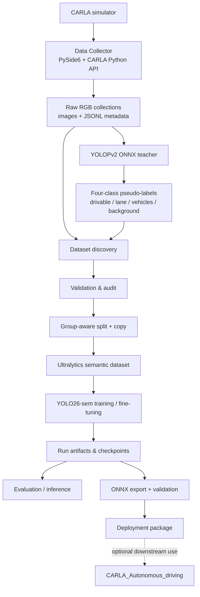

# Architecture

RoadForge is organized as two cooperating desktop workflows and a shared on-disk dataset contract.

## System overview

The dashed edge represents a possible downstream integration path, not an assertion that every exported model is already integrated or validated in the companion driving repository.

## Components

### 1. CARLA Data Collector — `datacollector/`

A separate PySide6 application connects to a running CARLA server through the CARLA Python API. It configures towns, weather, the ego vehicle, optional background traffic, and an RGB camera. Captures are stored as lossless PNG files with per-frame JSONL metadata and a collection manifest.

The collector's responsibilities are deliberately narrow: it records raw frames and metadata. It enumerates installed maps from the connected CARLA server and does not perform perception or write training labels during capture.

### 2. Teacher annotation — `datacollector/teacher_labeling.py`

The annotation interface runs one ONNX Runtime session for the compatible six-output YOLOPv2 graph. Outputs 4 and 5 provide the existing drivable-area and lane-line masks. Outputs 0–3 provide the COCO-80 vehicle detector; car, motorcycle, bus, and truck boxes are decoded, filtered with class-aware NMS, and converted to a vehicle mask with GrabCut (or a documented box fallback). The annotator creates a four-class combined mask and commits its manifest only after every output is written. Legacy three-class masks remain on disk and are reprocessed into a new output folder when selected.

The annotator is an offline stage. This separation keeps collection deterministic and makes the teacher model, provider, and annotation outputs independently inspectable.

### 3. Dataset and experiment workbench — `roadforge/`

The primary application is a PySide6 desktop interface. Its UI pages are backed by core modules:

| Module | Responsibility |
|---|---|
| `core/dataset.py` | Collection discovery, metadata indexing, image/mask validation, hashes, and report export |
| `core/splits.py` | Group-aware partitioning and non-destructive dataset preparation |
| `core/config.py` | Versioned training configuration, migration, and snapshots |
| `core/workers.py` | Background Qt workers for scanning, training, inference, and evaluation |
| `core/runtime.py` | Checkpoint verification, training support, prediction, evaluation, export, parity checks, benchmarks, and deployment packaging |
| `core/metrics.py` | Confusion matrix and segmentation metrics |
| `core/registry.py` | Local model-artifact registry with SHA-256 identifiers |

Long-running tasks execute in worker threads so the Qt event loop remains responsive. Training pause and stop requests are handled at epoch/checkpoint boundaries rather than interrupting a partially written checkpoint.

## File ownership and safety boundaries

- Raw collection folders are treated as source data. Dataset preparation copies valid pairs into a separate workspace.
- The scanner selects the combined semantic mask declared by the annotation manifest. It does not substitute binary masks or rendered visualizations.
- Prepared dataset manifests record exact source and destination paths, group assignments, split counts, and class-distribution summaries.
- Training run directories are unique. Configurations, split manifests, logs, metrics, and run metadata are saved with each run.
- Model registry removal deletes only a registry entry; it does not delete the referenced model file.
- ONNX export uses a temporary checkpoint copy and validates the resulting graph before reporting success.
